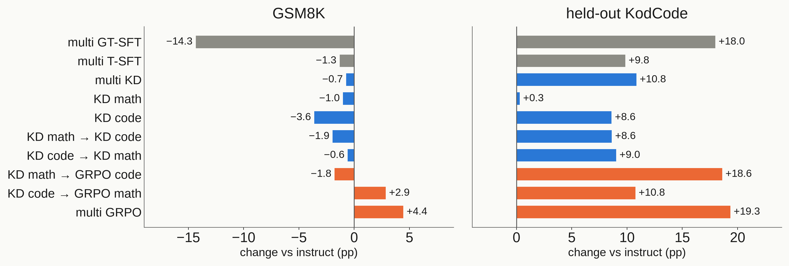
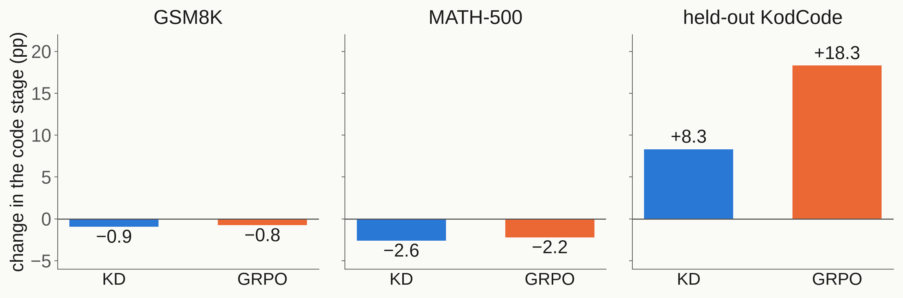
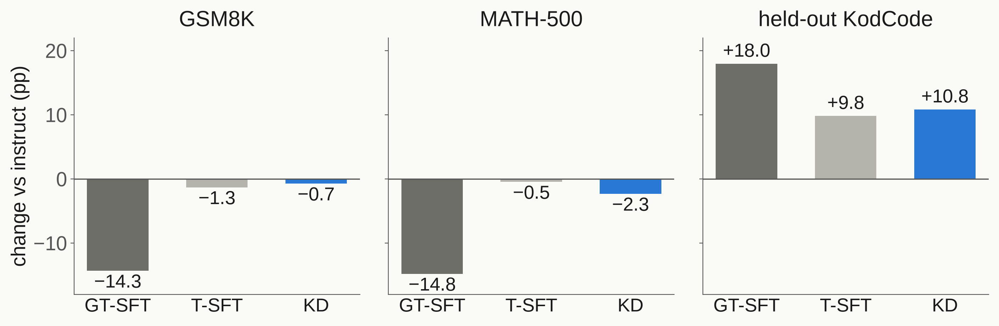
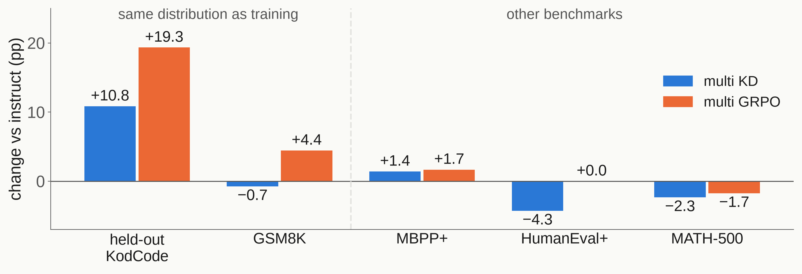

# Multi-teacher distillation vs distill-then-post-train

How should a small model learn math and code from two specialist teachers? We teach **Qwen2.5-0.5B-Instruct** from
**Qwen2.5-Math-7B-Instruct** and **Qwen2.5-Coder-7B-Instruct** and compare two routes:

- **Route 1, multi-teacher KD:** distill both teachers in one run, each prompt from the teacher of its own domain.
- **Route 2, KD then GRPO:** distill one domain, then train the other with GRPO, which needs only answer checks or
  unit tests, no teacher.

CS725 course project, IIT Bombay: Jayesh Kandpal, Mangesh Poojan, Shivang Goswami, Sancheet Basarikatti.
Report: [`docs/report.pdf`](docs/report.pdf). Slides: [`docs/slides.pdf`](docs/slides.pdf).

## Results

Change against the instruct model in percentage points (pp), 3-seed means, all benchmarked on one GPU type (RTX 6000
Ada). GSM8K and held-out KodCode come from the training distributions; MATH-500, MBPP+ and HumanEval+ do not.



1. **Route 2 wins on the domain it trains with GRPO** (held-out code +18.6 vs +10.8 for multi KD; GSM8K +2.9 vs -0.7).
   Multi GRPO, with no teacher, matches the better route 2 order in each domain.
2. **A GRPO second stage does not forget less than a KD second stage, but it learns more.** From the same KD math
   checkpoint, both code stages lose about the same math, and GRPO gains +18.3 pp of held-out code against +8.3.

   

3. **The training text matters more than the loss.** GT-SFT copies the short GSM8K solutions and loses 14 to 15 pp on
   both math tests; KD stays within about 2 pp of T-SFT at five times the cost.

   

4. **The gains stay on the two tests from the training distribution.**

   

   More than half of every held-out code gain is a format change. Our held-out tester imports the answer's code, so
   extra code after the function (example calls, prints, own asserts) runs first and, if it raises, fails every test.
   Instruct writes such code in 73% of its answers; trained models stop. EvalPlus deletes it for MBPP+ and HumanEval+.
   Deleting it here too:

   | method | held-out gain, as scored | extra code deleted |
   |---|---|---|
   | instruct (absolute %) | 50.0 | 60.8 |
   | multi GT-SFT | +18.0 | +7.2 |
   | multi T-SFT | +9.8 | +3.9 |
   | multi KD | +10.8 | +5.0 |
   | KD math → GRPO code | +18.6 | +7.8 |
   | multi GRPO | +19.3 | +8.5 |

5. **The students close at most about 10% of the gap to the teachers**, and **multi GRPO costs 14.1 GPU-hours per
   seed, more than six times multi KD (2.2).**

<details>
<summary>All numbers</summary>

| recipe | GSM8K | MATH-500 | MBPP+ | HumanEval+ | held-out code | GPU-hours |
|---|---|---|---|---|---|---|
| multi GT-SFT | -14.3 | -14.8 | +3.1 | +0.2 | +18.0 | 0.4 |
| multi T-SFT | -1.3 | -0.5 | +1.4 | -2.6 | +9.8 | 0.4 |
| multi KD (route 1) | -0.7 | -2.3 | +1.4 | -4.3 | +10.8 | 2.2 |
| KD math (first stage) | -1.0 | -0.3 | +0.4 | -2.2 | +0.3 | 0.6 |
| KD code (first stage) | -3.6 | -3.1 | +1.5 | -3.7 | +8.6 | 0.6 |
| KD math → KD code | -1.9 | -2.9 | +2.3 | -1.8 | +8.6 | 1.1 |
| KD code → KD math | -0.6 | -2.9 | +2.7 | -6.1 | +9.0 | 1.0 |
| KD math → GRPO code (route 2) | -1.8 | -2.5 | +2.3 | +2.4 | +18.6 | 4.0 |
| KD code → GRPO math (route 2) | +2.9 | -1.9 | +1.1 | -1.0 | +10.8 | 4.7 |
| multi GRPO | +4.4 | -1.7 | +1.7 | 0.0 | +19.3 | 14.1 |
| instruct (absolute %) | 50.6 | 33.4 | 41.0 | 33.5 | 50.0 | - |
| math teacher (absolute %) | 95.7 | 83.4 | 41.5 | 55.5 | 42.1 | - |
| code teacher (absolute %) | 88.2 | 71.0 | 71.4 | 85.4 | 77.8 | - |

GPU-hours = training hours × GPUs per seed, first stage included. Per-seed values: report appendix and
`5_recipes/results/`.

</details>

## Setup

- **Data:** 7,241 GSM8K and 7,269 KodCode-Light-RL-10K training prompts, 200 validation prompts per domain, and 2,527
  held-out KodCode problems (rows 7,473 to 9,999) as a test. Each teacher answered its prompts once (greedy, at most
  1,600 tokens); cut answers were dropped, wrong ones kept.
- **Recipes:** `multi` trains both domains in one run; `A → B` is a second stage B that starts from first stage A's
  best checkpoint. 8 recipes, 3 seeds each.
- **Losses** (N = answer tokens in the batch):

  ```
  GT-SFT, T-SFT: L = -(1/N) * sum over i,t of log p_student(y[i,t] | x[i], y[i,<t])    y = ground truth or teacher answer
  KD:            L =  (1/N) * sum over i,t of KL( p_teacher(. | x[i], y[i,<t]) || p_student(. | x[i], y[i,<t]) )
  GRPO:          A[i] = (r[i] - mean(r)) / (std(r) + 1e-4)    over the 8 answers sampled for one prompt
                 L = -(1/N) * sum over i,t of A[i] * log p_student(o[i,t] | q[i], o[i,<t])
  ```

  GRPO reward: math 1 if the last `\boxed{}` (else the last number) is right; code = fraction of unit tests passed;
  0 for an answer cut at the 768-token limit.
- **Training:** LoRA rank 16 (alpha 32) on all attention and MLP layers, fp32 weights with bf16 compute, AdamW, lr
  1e-4, 3% warmup then cosine decay. SFT and KD: 2 epochs, 32 prompts per step. GRPO (TRL 1.17.1): 1 epoch, 16 prompts
  × 8 answers per step. The checkpoint kept is the one with the best validation score (mean of math accuracy and code
  tests passed), checked every quarter epoch or every 50 GRPO steps.
- **Evaluation:** GSM8K (1,319), MATH-500, MBPP+ (378) and HumanEval+ (164) with EvalPlus, held-out KodCode (2,527).
  Greedy decoding, at most 1,600 tokens. The same weights give different greedy answers on different GPU types in
  bf16 (only 36% identical on GSM8K), so every final model is benchmarked on the Ada, and a change counts only if all 3
  seeds move the same way by more than that GPU noise.

**Before the mid-project checkpoint** we fine-tuned all weights with a mix of KD and ground truth cross-entropy
(`1_pre_checkpoint/`). Ground truth cross-entropy cost 6 to 14 pp of GSM8K, MBPP+ moved by at most 1.7 pp and
HumanEval+ fell in every setting. `1_pre_checkpoint/results_table.py` prints those results from `runs/`.

## Repository

```
0_data_gen/gen_data.py     teacher answers for the training prompts
1_pre_checkpoint/          before the mid-project checkpoint (full fine-tuning)
  bench.py                 benchmark a model before training     MODEL=...
  seq_kd.py                sequential KD                         ORDER=math,code ALPHA=0.5 SEED=0
  multi_kd.py              multi KD                              ALPHA=0.5 SEED=0
  runs/                    results of every run, results_table.py prints them
4_post_train/              first GRPO test run on code (pilot.log = its output)
5_recipes/                 the final experiments
  train_sft_kd.py          one GT-SFT, T-SFT or KD stage
  train_grpo.py            one GRPO stage
  eval_model.py            benchmark one model
  common.py                data, model loading, generation, validation, tests
  reward.py                runs an answer's code against unit tests (GRPO reward, held-out test)
  run.sh, reeval.sh        start the runs; benchmark best checkpoints again on the Ada
  analysis/                error analysis, held-out re-scoring, LoRA vs full fine-tuning, charts
  check/                   GPU-type checks (fp32, near-ties, repeats), reward-change and lr-choice checks
  results/                 logs and scores of every run
docs/, figures/            report, slides, the charts above
```

## How to run

Python 3.12, torch 2.13.0, transformers 5.20.2, trl 1.17.1, peft 0.21.2, datasets 5.1.0, math-verify 0.9.0, evalplus
0.3.1, pytest; 48 GB GPUs. The teacher answers are downloaded from the Hugging Face dataset `jajamken/FML_project`.

```bash
cd 5_recipes
bash run.sh multi_sft 0          # multi GT-SFT and multi T-SFT, seeds 0 1 2 (SEEDS=0 for one seed)
bash run.sh multi_kd 0,1         # student on GPU 0, both teachers on GPU 1
bash run.sh kd_math_chain 0      # KD math, then KD math -> KD code
bash run.sh rl_code 0            # KD math -> GRPO code; also kd_code_chain, rl_math, multi_rl, refs
```

Each run writes `log.json`, the best adapter in `best/` and the test results in `results_best/`.

## Resources

Models: [Qwen2.5-0.5B-Instruct](https://huggingface.co/Qwen/Qwen2.5-0.5B-Instruct),
[Qwen2.5-Math-7B-Instruct](https://huggingface.co/Qwen/Qwen2.5-Math-7B-Instruct),
[Qwen2.5-Coder-7B-Instruct](https://huggingface.co/Qwen/Qwen2.5-Coder-7B-Instruct).
Data: [GSM8K](https://huggingface.co/datasets/openai/gsm8k),
[KodCode-Light-RL-10K](https://huggingface.co/datasets/KodCode/KodCode-Light-RL-10K),
[MATH-500](https://huggingface.co/datasets/HuggingFaceH4/MATH-500), [EvalPlus](https://github.com/evalplus/evalplus).
Libraries: [TRL](https://github.com/huggingface/trl), [PEFT](https://github.com/huggingface/peft),
[Math-Verify](https://github.com/huggingface/Math-Verify). Papers: see the report's references.

### Reading list

0. Video lectures

- [x] [CS336 Post-training lecture](https://www.youtube.com/watch?v=2oH6PWPrYFo)
- [ ] [UCLA RL for LLMs](https://www.youtube.com/playlist?list=PLir0BWtR5vRp5dqaouyMU-oTSzaU5LK9r)
- [ ] [Post-training course](https://www.youtube.com/playlist?list=PLL1tdVxB1CpVpEtMHxwuR4uI4Lxjw00_y)

1. Knowledge Distillation

- [x] [Distilling the Knowledge in a Neural Network]( https://arxiv.org/abs/1503.02531)
- [x] [Sequence-Level Knowledge Distillation]( https://arxiv.org/abs/1606.07947)
- [ ] [On the Efficacy of Knowledge Distillation]( https://arxiv.org/abs/1910.01348)
- [ ] [MiniLLM]( https://arxiv.org/abs/2306.08543)
- [ ] [Knowledge Fusion of Large Language Models]( https://arxiv.org/abs/2401.10491)
- [ ] [On-Policy Distillation of Language Models]( https://arxiv.org/abs/2306.13649)

2. RL

- [ ] []()
- [ ] []()
- [ ] []()
- [ ] []()

3. Post training

- [ ] [SFT Memorizes, RL Generalizes]( https://arxiv.org/abs/2501.17161)
- [ ] [RL's Razor]( https://arxiv.org/abs/2509.04259)
- [ ] [Does Reinforcement Learning Really Incentivize Reasoning Capacity in LLMs Beyond the Base Model?]( https://arxiv.org/abs/2504.13837)
- [ ] [Spurious Rewards: Rethinking Training Signals in RLVR]( https://arxiv.org/abs/2506.10947)
